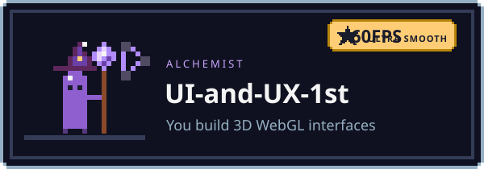

<!--
  Akshay Katiyar (Akshay-Katiyar): Systems architect, cross-platform founder and open-source creator.
  Open-source Claude Code skills, AI agent swarms: Indian statutory law platform (Open Acts), 3D WebGL (UI and UX 1st), and 30+ native applications.
  GitHub: https://github.com/Akshay-Katiyar
  Email: 192348432+Akshay-Katiyar@users.noreply.github.com
-->

 

**Battle menu**

- **Level up**: explore <a href="https://github.com/Akshay-Katiyar/UI-and-UX-1st">UI-and-UX-1st</a>, 19,849+ Bare Acts index and 30+ Flutter production apps
- **Attune skills**: deploy <a href="https://github.com/Akshay-Katiyar">Open Acts</a>, <a href="https://github.com/Akshay-Katiyar">CaseNova</a> or <a href="https://github.com/Akshay-Katiyar/UI-and-UX-1st">UI-and-UX-1st</a>
- **Travel**: <a href="https://github.com/Akshay-Katiyar">GitHub Profile</a>, <a href="https://www.linkedin.com/in/axkshay-katiyar">LinkedIn</a>, <a href="https://www.youtube.com/@LearningHubBox">YouTube</a> or <a href="mailto:192348432+Akshay-Katiyar@users.noreply.github.com">Direct Dispatch</a>
- **Torch**: star a repo you use, it keeps the flame burning

<!-- DYNAMIC REAL-TIME TYPING TERMINAL -->

<!-- VERIFIED IDENTITY & CHANNEL BADGES -->

  
  
  
  
  

  <b>GHOST (Akshay Katiyar)</b> builds autonomous <b>AI Agent swarms</b>, statutory legal engines and high-performance cross-platform software. 
  Maker of Open Acts, CaseNova, UI-and-UX-1st, and 30+ native applications. Free and MIT licensed.

 

**Enter the Forge.** Architecting autonomous AI agent swarms, statutory legal engines (19,849+ Bare Acts in Open Acts), precedent intelligence (CaseNova), and 30+ high-performance native Flutter apps. Free and MIT licensed.

##  About Me

Autonomous systems architect and cross-platform engineer. I build free, open-source AI workflows, agent swarms, and high-performance software. Each one is an engineered system: install it, point it at your objective, and it executes with deterministic quality gates.

They cover full statutory legal corpus indexing (19,849+ Bare Acts in Open Acts), generative AI case intelligence (CaseNova), realtime WebGL & Three.js scrollytelling (UI-and-UX-1st), and 30+ production-grade mobile applications. The work traditional consultancies bill tens of thousands for, delivered as high-agency code.

I actively build with **Claude Code**, **Gemini 3.8 Flash / 2.0**, **Antigravity CLI**, and autonomous agent swarm ecosystems.

---

## ⚡ Live Telemetry & GitHub Showcase

<table>
  <tr>
    <td width="50%" align="center">
      
    </td>
    <td width="50%" align="center">
      
    </td>
  </tr>
  <tr>
    <td colspan="2" align="center">
      
    </td>
  </tr>
</table>

<!-- CONTRIBUTION SNAKE ANIMATION -->
<picture>
  <source media="(prefers-color-scheme: dark)" srcset="https://raw.githubusercontent.com/Akshay-Katiyar/Akshay-Katiyar/output/github-contribution-grid-snake-dark.svg">
  <source media="(prefers-color-scheme: light)" srcset="https://raw.githubusercontent.com/Akshay-Katiyar/Akshay-Katiyar/output/github-contribution-grid-snake.svg">
  
</picture>

---

##  Choose Your Class: Autonomous Systems & Skills

Pick your discipline. Each class commands a specialized autonomous engine.

<table>
  <tr>
    <td width="50%" valign="top">
      
      
<b><a href="https://github.com/Akshay-Katiyar">Open Acts</a></b>: Autonomous Indian statutory law corpus &amp; Bare Acts indexing engine: 19,849+ Acts, BNS/BNSS/BSA, and sub-millisecond Cloudflare edge search.

    </td>
    <td width="50%" valign="top">
      
      
<b><a href="https://github.com/Akshay-Katiyar">CaseNova</a></b>: Advanced AI Case Intelligence and Judicial Precedent Analysis Platform: citation networks, statutory synthesis, and multi-model verification.

    </td>
  </tr>
  <tr>
    <td width="50%" valign="top">
      
      
<b><a href="https://github.com/Akshay-Katiyar">The Flutter Forge</a></b>: High-performance cross-platform software forge: 30+ production iOS, Android, and desktop apps with reactive state and offline-first persistence.

    </td>
    <td width="50%" valign="top">
      
      
<b><a href="https://github.com/Akshay-Katiyar/UI-and-UX-1st">UI-and-UX-1st</a></b>: High-performance interactive 3D WebGL, scrollytelling, Three.js shaders, and anti-slop design system engineering.

    </td>
  </tr>
</table>

<picture></picture>

 

- **[Open Acts Core](https://github.com/Akshay-Katiyar)**: Full corpus of 19,849+ Central and State Bare Acts, indexed with sub-millisecond edge vector search.
- **[CaseNova Precedent Engine](https://github.com/Akshay-Katiyar)**: Autonomous judicial precedent analyzer and case law intelligence engine.
- **[UI-and-UX-1st Experience](https://github.com/Akshay-Katiyar/UI-and-UX-1st)**: 60 FPS WebGL 3D scrollytelling, Three.js shaders, and anti-slop design system.
- **[FinTrack Native](https://github.com/Akshay-Katiyar)**: Production Flutter personal finance tracker with offline-first SQLite and AES encryption.
- **[MealVault](https://github.com/Akshay-Katiyar)**: Production dietary planning and nutrition tracker with custom barcode scanner and local storage.
- **[WeatherSphere](https://github.com/Akshay-Katiyar)**: Real-time radar weather client with interactive canvas animations and multi-city telemetry.
- **[HabitFlow](https://github.com/Akshay-Katiyar)**: Habit tracking engine with streak preservation, heatmap analytics, and local notifications.
- **[JusticeTracker](https://github.com/Akshay-Katiyar)**: Legal case hearing scheduler and cause-list tracker for Indian courts.
- **[MediaForge Suite](https://github.com/Akshay-Katiyar)**: High-speed audio/video transcoder and batch converter built with Flutter and FFmpeg.

##  Boss Fight: The $50K Proprietary Monolith

<picture></picture>

 

**The $50K Proprietary Monolith.** Weakness: autonomous agent swarms and open-source legaltech you run yourself. Open Acts, CaseNova, and high-performance native Flutter software shatter paywalled databases, eliminate enterprise vendor lock-in, and deliver sub-millisecond execution traditional consultancies charge tens of thousands for. 100% Free & MIT licensed.

**Deploy the Swarm.** High-agency autonomous agent swarms, 7-gate quality delivery contracts, and sub-millisecond Cloudflare edge architectures built together.

##  Tech Stack

---

## 🛠️ The Ultimate Developer Showcase & Categorized Skill Engine

  

<b>1. Core Programming Languages (Click to Expand / Collapse)</b>

 

> 📖 *Full catalog of 36+ languages, HEX colors, and devicon slugs available in [`docs/programming-language-badges.md`](./docs/programming-language-badges.md).*

<b>2. AI, Machine Learning, RAG & Autonomous Agent Swarms</b>

 

> 📖 *Full matrix of AI frameworks, vector DBs, and LLM tooling in [`docs/ai-ml-agent-badges.md`](./docs/ai-ml-agent-badges.md).*

<b>3. Frontend Development, WebGL & 3D Systems</b>

 

> 📖 *Full catalog of frontend engines, bundlers, and motion libraries in [`docs/frontend-badges.md`](./docs/frontend-badges.md).*

<b>4. Backend Runtimes, APIs & Microservices</b>

 

> 📖 *Full catalog of 30+ backend runtimes, web frameworks, and protocols in [`docs/backend-badges.md`](./docs/backend-badges.md).*

<b>5. Databases, Storage & Big Data Engineering</b>

 

> 📖 *Full catalog of SQL, NoSQL, Caching, and Big Data technologies in [`docs/database-badges.md`](./docs/database-badges.md).*

<b>6. Cloud Infrastructure, Edge & DevOps CI/CD</b>

 

> 📖 *Full catalog of cloud hyperscalers, containers, and monitoring in [`docs/cloud-devops-badges.md`](./docs/cloud-devops-badges.md).*

<b>7. Cybersecurity, Application Security & Defense</b>

 

> 📖 *Full catalog of AppSec, SAST/DAST, and defensive security tooling in [`docs/cybersecurity-badges.md`](./docs/cybersecurity-badges.md).*

<b>8. Developer Tools, IDEs & Ecosystem</b>

 

> 📖 *Full catalog of 37+ IDEs, shells, and package managers in [`docs/developer-tools-badges.md`](./docs/developer-tools-badges.md).*

---

## 📚 Complete Architectural Documentation & Catalogs

Explore the deep technical specifications, API schemas, and maintenance runbooks across all 14 categories:

| Document | Scope & Focus | Technologies Cataloged |
|---|---|---|
| [`docs/profile-badge-catalog.md`](./docs/profile-badge-catalog.md) | **Master Catalog**: All 14 categories in one comprehensive reference | 350+ Badges & Shields |
| [`docs/profile-badge-sources.md`](./docs/profile-badge-sources.md) | **API & Architecture Directory**: Rate limits, tokens, self-hosting runbooks | 22 Service Providers |
| [`docs/programming-language-badges.md`](./docs/programming-language-badges.md) | Language badges, official brand HEX codes, and Devicon mappings | 36 Programming Languages |
| [`docs/frontend-badges.md`](./docs/frontend-badges.md) | Frameworks, reactive UI kits, WebGL, Three.js, bundlers | 33 Frontend Technologies |
| [`docs/backend-badges.md`](./docs/backend-badges.md) | Server runtimes, REST/gRPC/GraphQL APIs, message queues | 30 Backend Runtimes |
| [`docs/ai-ml-agent-badges.md`](./docs/ai-ml-agent-badges.md) | LLMs, Agent swarms, vector databases, RAG, inference clusters | 27 AI/ML Technologies |
| [`docs/database-badges.md`](./docs/database-badges.md) | SQL, NoSQL, in-memory caching, data warehouses | 24 Database Systems |
| [`docs/cloud-devops-badges.md`](./docs/cloud-devops-badges.md) | Hyperscalers, Docker, Kubernetes, CI/CD, Observability | 35 DevOps Tools |
| [`docs/cybersecurity-badges.md`](./docs/cybersecurity-badges.md) | AppSec, SAST, penetration testing, defensive telemetry | 22 Security Tools |
| [`docs/developer-tools-badges.md`](./docs/developer-tools-badges.md) | IDEs, editors, terminals, package managers, and design tools | 37 Developer Tools |
| [`docs/external-developer-profiles.md`](./docs/external-developer-profiles.md) | LeetCode, Codeforces, HackerRank, Kaggle, WakaTime integrations | 10 Platforms |
| [`docs/github-native-achievements.md`](./docs/github-native-achievements.md) | Official 4-tier achievement criteria (Pull Shark, Quickdraw, etc.) | Official GitHub Badges |
| [`docs/deprecated-and-broken-widgets.md`](./docs/deprecated-and-broken-widgets.md) | Deprecated endpoints, Vercel 402 outages, Heroku removals | 12 Deprecated Services |
| [`docs/setup-guide.md`](./docs/setup-guide.md) | Setup instructions, snake automation, CI validation workflows | Production Guide |

---

##  FAQ

<b>Who is GHOST (Akshay Katiyar)?</b>

 
<b>GHOST (Akshay Katiyar)</b> is an Autonomous Systems Architect, Legaltech Pioneer, and AI Agent Engineer. He builds autonomous AI agent swarms, statutory legal engines (<a href="https://github.com/Akshay-Katiyar">Open Acts</a>, <a href="https://github.com/Akshay-Katiyar">CaseNova</a>), high-performance 3D WebGL experiences (<a href="https://github.com/Akshay-Katiyar/UI-and-UX-1st">UI-and-UX-1st</a>), and 30+ native Flutter applications. Connect on <a href="https://github.com/Akshay-Katiyar">GitHub</a>, <a href="https://www.linkedin.com/in/axkshay-katiyar">LinkedIn</a>, or watch on <a href="https://www.youtube.com/@LearningHubBox">YouTube</a>.

<b>What is Open Acts?</b>

 
India's comprehensive open-source Statutory Law &amp; Legal Research Platform built by GHOST. It indexes 19,849+ Bare Acts, the new criminal laws (BNS, BNSS, BSA), Supreme Court Precedents, bilingual Hindi/English full-text search, sub-millisecond Cloudflare Edge API, and zero-latency offline SQLite storage. Free and MIT licensed for every citizen and legal practitioner.

<b>What are GHOST's Autonomous AI Agent Swarms & Skills?</b>

 
Engineered agentic systems designed by GHOST that integrate with Claude Code, Gemini Antigravity, and MCP servers. They execute bounded objectives with multi-agent parallel decomposition, strict 7-gate quality contracts, and deterministic verification. Install a skill, point it at your objective, and it runs autonomously.

<b>Are GHOST's systems, apps, and plugins free?</b>

 
Yes, 100% Free and MIT licensed. Every system built by GHOST—including Open Acts, CaseNova, UI-and-UX-1st, and the 30+ native Flutter applications—is completely open-source with zero paywalls, zero vendor lock-in, and full source code available on GitHub.

<b>Which GHOST system or class should I start with?</b>

 
• <b>Open Acts (Architect)</b>: For comprehensive statutory law indexing, 19,849+ Bare Acts, or legal search APIs. 
• <b>CaseNova (Inquisitor)</b>: For AI-powered judicial precedent reasoning, citation verification, and case law intelligence. 
• <b>UI-and-UX-1st (Alchemist)</b>: For high-performance interactive 3D WebGL interfaces, scrollytelling, and Three.js shaders. 
• <b>The Flutter Forge (Forgemaster)</b>: For production-grade, offline-first mobile and desktop applications.

<b>How does GHOST ensure zero hallucination in legal & autonomous systems?</b>

 
Through a multi-model verification loop and statutory grounding: Open Acts indexes exact bare act sections and gazette notifications directly into vector embeddings, while CaseNova cross-references rulings against official Supreme Court citation networks. Autonomous agent swarms enforce independent verification gates before any output is finalized.

<b>Where can I learn and connect with GHOST?</b>

 
Explore open-source repositories and agent architectures on <a href="https://github.com/Akshay-Katiyar">GitHub</a>, follow professional updates on <a href="https://www.linkedin.com/in/axkshay-katiyar">LinkedIn</a>, and subscribe to tutorials and system walk-throughs on YouTube at <a href="https://www.youtube.com/@LearningHubBox">@LearningHubBox</a>.

---

##  Connect

  
  
  
  
  

