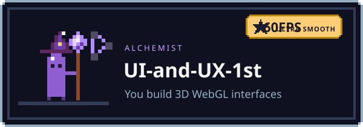

<!--
  Akshay Katiyar (Akshay-Katiyar): Systems architect, cross-platform founder and open-source creator.
  Open-source Claude Code skills, AI agent swarms: Indian statutory law platform (Open Acts), 3D WebGL (UI and UX 1st), and 30+ native applications.
  GitHub: https://github.com/Akshay-Katiyar
  Email: 192348432+Akshay-Katiyar@users.noreply.github.com
-->

 

**Bonfire menu**

- **Level up**: explore <a href="https://github.com/Akshay-Katiyar/UI-and-UX-1st">UI-and-UX-1st</a>, 19,849+ Bare Acts index and 30+ Flutter production apps
- **Attune skills**: install <a href="https://github.com/AgriciDaniel/claude-seo">claude-seo</a>, <a href="https://github.com/AgriciDaniel/claude-ads">claude-ads</a> or <a href="https://github.com/AgriciDaniel/claude-blog">claude-blog</a>
- **Travel**: <a href="https://github.com/Akshay-Katiyar">GitHub Profile</a> or <a href="mailto:192348432+Akshay-Katiyar@users.noreply.github.com">Direct Dispatch</a>
- **Kindle**: star a repo you use, it keeps the fire going

  <b>Akshay Katiyar</b> builds autonomous <b>AI Agent swarms</b>, statutory legal engines and high-performance cross-platform software. 
  Maker of Open Acts, CaseNova, UI-and-UX-1st, and 30+ native applications. Free and MIT licensed.

 

**Join the party.** Building with Claude Code, Gemini Antigravity, and autonomous agent swarms. Ask questions, share workflows, get help when a skill breaks.

##  About Me

Autonomous systems architect and cross-platform engineer. I build free, open-source AI workflows, agent swarms, and high-performance software. Each one is an engineered system: install it, point it at your objective, and it executes with deterministic quality gates.

They cover full statutory legal corpus indexing (19,849+ Bare Acts in Open Acts), generative AI case intelligence (CaseNova), realtime WebGL & Three.js scrollytelling (UI-and-UX-1st), and 30+ production-grade mobile applications. The work traditional consultancies bill tens of thousands for, delivered as high-agency code.

I actively build with **Claude Code**, **Gemini 3.8 Flash / 2.0**, **Antigravity CLI**, and the **claude-seo**, **claude-ads**, and **claude-blog** skill ecosystems.

##  Claude Code Skills: Choose Your Class

Pick the one that sounds like you. Each class comes with its skill.

<table>
  <tr>
    <td width="50%" valign="top">
      
      
<b><a href="https://github.com/AgriciDaniel/claude-seo">claude-seo</a></b>: AI SEO for Claude Code: technical audits, schema, E-E-A-T, local SEO and GEO for AI search.

    </td>
    <td width="50%" valign="top">
      
      
<b><a href="https://github.com/AgriciDaniel/claude-ads">claude-ads</a></b>: Google Ads and Meta ads audits across 12 ad platforms, with scored reports.

    </td>
  </tr>
  <tr>
    <td width="50%" valign="top">
      
      
<b><a href="https://github.com/AgriciDaniel/claude-blog">claude-blog</a></b>: AI blog writer that ranks on Google and gets cited in AI search.

    </td>
    <td width="50%" valign="top">
      
      
<b><a href="https://github.com/AgriciDaniel/claude-obsidian">claude-obsidian</a></b>: AI second brain for Obsidian. Drop in any source, Claude links and files it.

    </td>
  </tr>
</table>

<picture></picture>

 

- **[UI-and-UX-1st](https://github.com/Akshay-Katiyar/UI-and-UX-1st)**: High-performance interactive 3D WebGL, scrollytelling and design system experience.
- **[banana-claude](https://github.com/AgriciDaniel/banana-claude)**: AI image generation skill for Claude Code, powered by Gemini.
- **[compass](https://github.com/AgriciDaniel/compass)**: Run your whole life out of Obsidian. Daily questions, planning, habits, tasks and an AI assistant in the vault.
- **[Open Acts](https://github.com/Akshay-Katiyar)**: Autonomous Indian Statutory Law & Legal Research Platform (19,849+ Bare Acts, BNS/BNSS/BSA, Cloudflare Edge API).
- **[CaseNova](https://github.com/Akshay-Katiyar)**: Advanced AI Case Intelligence and Judicial Precedent Analysis Platform.
- **[The Flutter Forge](https://github.com/Akshay-Katiyar)**: 30+ native applications (FinTrack, MealVault, WeatherSphere, HabitFlow, JusticeTracker, and complete media converter suite).
- **[claude-cybersecurity](https://github.com/AgriciDaniel/claude-cybersecurity)**: Security code review skill for Claude Code. 8 specialist agents, OWASP, CWE Top 25 and MITRE ATT&CK.
- **[claude-shorts](https://github.com/AgriciDaniel/claude-shorts)**: Turns long videos into Shorts with animated captions, inside Claude Code.

##  Boss Fight

<picture></picture>

 

**The $10K/mo Agency Retainer.** Weakness: open-source skills you run yourself. claude-seo, claude-ads and claude-blog do the audits, the ads checks and the posts. MIT licensed.

**Want the full build?** High-agency autonomous agent swarms, 7-gate quality delivery contracts, and sub-millisecond Cloudflare edge architectures built together.

##  FAQ

<b>Who is Akshay Katiyar?</b>

 
An Autonomous Systems Architect and AI Agent Engineer who builds open-source Claude Code skills, legal intelligence engines (Open Acts, CaseNova), and cross-platform apps. GitHub: <a href="https://github.com/Akshay-Katiyar">github.com/Akshay-Katiyar</a>.

<b>What is Open Acts?</b>

 
India's comprehensive Statutory Law & Legal Research Platform covering 19,849+ Bare Acts, the new criminal laws (BNS, BNSS, BSA), Supreme Court Precedents, bilingual Hindi/English full-text search, and a zero-latency offline SQLite reader.

<b>What are Claude Code skills?</b>

 
Folders of instructions, scripts and reference files that Claude Code loads when a task needs them. A plugin bundles skills, agents and commands so you can install them with <code>/plugin install</code>.

<b>Are these Claude Code plugins free?</b>

 
Yes. Every repo here is MIT licensed. Some skills can connect paid data APIs, such as DataForSEO, if you choose to.

<b>Which AI SEO tool should I start with?</b>

 
claude-seo for SEO, GEO and AI search. claude-ads for Google Ads, Meta ads and other ad platforms. claude-blog for blog posts. claude-obsidian for a second brain.

<b>How to rank on Google and in AI search with these skills?</b>

 
Install claude-seo and run <code>/seo audit</code> on your site. It checks technical SEO, schema, content and AI visibility, then lists what to fix for Google, ChatGPT and Perplexity. claude-blog writes the posts.

<b>Where can I learn Claude Code?</b>

 
Follow open-source releases on GitHub, explore the official skill suites, and inspect the layered skill architectures directly in the repositories.

##  Tech Stack

##  Connect

  
  
  
  
  

