<!--
  Akshay Katiyar (Akshay-Katiyar): Systems architect, cross-platform founder and open-source creator.
  Open-source Claude Code skills, AI agent swarms: Indian statutory law platform (Open Acts), 3D WebGL (UI and UX 1st), and 30+ native applications.
  GitHub: https://github.com/Akshay-Katiyar
  Email: 192348432+Akshay-Katiyar@users.noreply.github.com
-->

 

**Battle menu**

- **Level up**: explore <a href="https://github.com/Akshay-Katiyar/UI-and-UX-1st">UI-and-UX-1st</a>, 19,849+ Bare Acts index and 30+ Flutter production apps
- **Attune skills**: deploy <a href="https://github.com/Akshay-Katiyar">Open Acts</a>, <a href="https://github.com/Akshay-Katiyar">CaseNova</a> or <a href="https://github.com/Akshay-Katiyar/UI-and-UX-1st">UI-and-UX-1st</a>
- **Travel**: <a href="https://github.com/Akshay-Katiyar">GitHub Profile</a> or <a href="mailto:192348432+Akshay-Katiyar@users.noreply.github.com">Direct Dispatch</a>
- **Torch**: star a repo you use, it keeps the flame burning

  <b>GHOST (Akshay Katiyar)</b> builds autonomous <b>AI Agent swarms</b>, statutory legal engines and high-performance cross-platform software. 
  Maker of Open Acts, CaseNova, UI-and-UX-1st, and 30+ native applications. Free and MIT licensed.

 

**Enter the Forge.** Architecting autonomous AI agent swarms, statutory legal engines (19,849+ Bare Acts in Open Acts), precedent intelligence (CaseNova), and 30+ high-performance native Flutter apps. Free and MIT licensed.

##  About Me

Autonomous systems architect and cross-platform engineer. I build free, open-source AI workflows, agent swarms, and high-performance software. Each one is an engineered system: install it, point it at your objective, and it executes with deterministic quality gates.

They cover full statutory legal corpus indexing (19,849+ Bare Acts in Open Acts), generative AI case intelligence (CaseNova), realtime WebGL & Three.js scrollytelling (UI-and-UX-1st), and 30+ production-grade mobile applications. The work traditional consultancies bill tens of thousands for, delivered as high-agency code.

I actively build with **Claude Code**, **Gemini 3.8 Flash / 2.0**, **Antigravity CLI**, and autonomous agent swarm ecosystems.

##  Choose Your Class: Autonomous Systems & Skills

Pick your discipline. Each class commands a specialized autonomous engine.

<table>
  <tr>
    <td width="50%" valign="top">
      
      
<b><a href="https://github.com/Akshay-Katiyar">Open Acts</a></b>: Autonomous Indian statutory law corpus &amp; Bare Acts indexing engine: 19,849+ Acts, BNS/BNSS/BSA, and sub-millisecond Cloudflare edge search.

    </td>
    <td width="50%" valign="top">
      
      
<b><a href="https://github.com/Akshay-Katiyar">CaseNova</a></b>: Advanced AI Case Intelligence and Judicial Precedent Analysis Platform: citation networks, statutory synthesis, and multi-model verification.

    </td>
  </tr>
  <tr>
    <td width="50%" valign="top">
      
      
<b><a href="https://github.com/Akshay-Katiyar">The Flutter Forge</a></b>: High-performance cross-platform software forge: 30+ production iOS, Android, and desktop apps with reactive state and offline-first persistence.

    </td>
    <td width="50%" valign="top">
      
      
<b><a href="https://github.com/Akshay-Katiyar/UI-and-UX-1st">UI-and-UX-1st</a></b>: High-performance interactive 3D WebGL, scrollytelling, Three.js shaders, and anti-slop design system engineering.

    </td>
  </tr>
</table>

<picture></picture>

 

- **[Open Acts Core](https://github.com/Akshay-Katiyar)**: Full corpus of 19,849+ Central and State Bare Acts, indexed with sub-millisecond edge vector search.
- **[CaseNova Precedent Engine](https://github.com/Akshay-Katiyar)**: Autonomous judicial precedent analyzer and case law intelligence engine.
- **[UI-and-UX-1st Experience](https://github.com/Akshay-Katiyar/UI-and-UX-1st)**: 60 FPS WebGL 3D scrollytelling, Three.js shaders, and anti-slop design system.
- **[FinTrack Native](https://github.com/Akshay-Katiyar)**: Production Flutter personal finance tracker with offline-first SQLite and AES encryption.
- **[MealVault](https://github.com/Akshay-Katiyar)**: Production dietary planning and nutrition tracker with custom barcode scanner and local storage.
- **[WeatherSphere](https://github.com/Akshay-Katiyar)**: Real-time radar weather client with interactive canvas animations and multi-city telemetry.
- **[HabitFlow](https://github.com/Akshay-Katiyar)**: Habit tracking engine with streak preservation, heatmap analytics, and local notifications.
- **[JusticeTracker](https://github.com/Akshay-Katiyar)**: Legal case hearing scheduler and cause-list tracker for Indian courts.
- **[MediaForge Suite](https://github.com/Akshay-Katiyar)**: High-speed audio/video transcoder and batch converter built with Flutter and FFmpeg.

##  Boss Fight

<picture></picture>

 

**The $10K/mo Agency Retainer.** Weakness: autonomous agent swarms and open-source systems you run yourself. Open Acts, CaseNova, and high-performance native software deliver the work traditional consultancies overcharge for. Free and MIT licensed.

**Want the full build?** High-agency autonomous agent swarms, 7-gate quality delivery contracts, and sub-millisecond Cloudflare edge architectures built together.

##  FAQ

<b>Who is Akshay Katiyar?</b>

 
An Autonomous Systems Architect and AI Agent Engineer who builds open-source Claude Code skills, legal intelligence engines (Open Acts, CaseNova), and cross-platform apps. GitHub: <a href="https://github.com/Akshay-Katiyar">github.com/Akshay-Katiyar</a>.

<b>What is Open Acts?</b>

 
India's comprehensive Statutory Law & Legal Research Platform covering 19,849+ Bare Acts, the new criminal laws (BNS, BNSS, BSA), Supreme Court Precedents, bilingual Hindi/English full-text search, and a zero-latency offline SQLite reader.

<b>What are Claude Code skills?</b>

 
Folders of instructions, scripts and reference files that Claude Code loads when a task needs them. A plugin bundles skills, agents and commands so you can install them with <code>/plugin install</code>.

<b>Are these Claude Code plugins free?</b>

 
Yes. Every repo here is MIT licensed. Some skills can connect paid data APIs, such as DataForSEO, if you choose to.

<b>Which AI SEO tool should I start with?</b>

 
claude-seo for SEO, GEO and AI search. claude-ads for Google Ads, Meta ads and other ad platforms. claude-blog for blog posts. claude-obsidian for a second brain.

<b>How to rank on Google and in AI search with these skills?</b>

 
Install claude-seo and run <code>/seo audit</code> on your site. It checks technical SEO, schema, content and AI visibility, then lists what to fix for Google, ChatGPT and Perplexity. claude-blog writes the posts.

<b>Where can I learn Claude Code?</b>

 
Follow open-source releases on GitHub, explore the official skill suites, and inspect the layered skill architectures directly in the repositories.

##  Tech Stack

##  Connect

  
  
  
  
  

