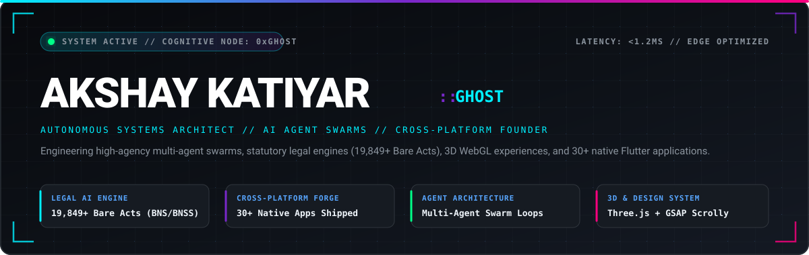
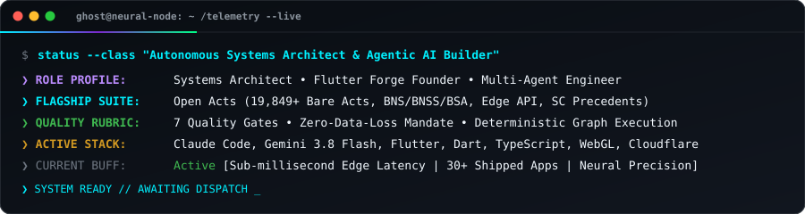

<div align="center">

  <!-- Hero Banner SVG -->
  <a href="https://github.com/Akshay-Katiyar">
    
  </a>

  <br/><br/>

  <!-- Status & Architecture Badges -->
  <p align="center">
    <a href="https://github.com/Akshay-Katiyar"></a>
    <a href="https://github.com/Akshay-Katiyar"></a>
    <a href="https://github.com/Akshay-Katiyar"></a>
    <a href="https://github.com/Akshay-Katiyar"></a>
    <a href="https://github.com/Akshay-Katiyar"></a>
  </p>

  <br/>

  <h3>⚡ Autonomous Systems Architect • Agentic AI Builder • Cross-Platform Founder</h3>
  <p align="center">
    <i>"Architecting deterministic multi-agent swarms, high-throughput legal intelligence platforms, and high-performance cross-platform software that refuses to compromise on speed, aesthetic taste, or precision."</i>
  </p>

  <p align="center">
    <a href="#-flagship-ecosystems--suites"><b>Explore Flagships</b></a> •
    <a href="#-boss-fight-enter-the-fog"><b>Boss Fight (Telemetry)</b></a> •
    <a href="#-the-engineering-forge--tech-stack"><b>Tech Stack</b></a> •
    <a href="#-github-telemetry--pulse"><b>Live Pulse</b></a> •
    <a href="#-faq--architectural-brief"><b>FAQ</b></a> •
    <a href="#-connect--dispatch"><b>Connect</b></a>
  </p>

</div>

---

### 🔱 Flagship Ecosystems & Suites

<table>
  <tr>
    <td width="50%" valign="top">
      <h3>🏛️ Open Acts &amp; CaseNova</h3>
      <p><b>Autonomous Indian Statutory &amp; Precedent Intelligence</b></p>
      <p>A mission-critical legal research infrastructure indexing India's entire statutory corpus with sub-millisecond vector and lexical search.</p>
      <ul>
        <li><b>19,849+ Bare Acts</b>: Full codification including Bharatiya Nyaya Sanhita (BNS), BNSS, and BSA with cross-sectional mapping.</li>
        <li><b>Edge Architecture</b>: Cloudflare Worker API resolving statutory citations, bilingual (English/Hindi) neural text, and Supreme Court precedent graphs.</li>
        <li><b>Offline Engine</b>: Production Flutter mobile client with zero-latency local SQLite reader and full-text search capability.</li>
        <li><b>AI Case Intelligence</b>: CaseNova automated judicial brief synthesizer and constitutional doctrine auditor.</li>
      </ul>
      <p>
        
        
      </p>
    </td>
    <td width="50%" valign="top">
      <h3>🌐 UI and UX 1st</h3>
      <p><b>Interactive 3D WebGL &amp; GSAP Scrollytelling</b></p>
      <p>An anti-slop, Swiss-grade digital showroom designed to break templated conventions through hardware-accelerated creative computing.</p>
      <ul>
        <li><b>Realtime WebGL Canvas</b>: Custom Three.js geometry, particle simulation, and physics-driven interaction.</li>
        <li><b>GSAP Motion Choreography</b>: Frame-perfect ScrollTrigger pinning, scrubbed timelines, and dynamic responsive morphs.</li>
        <li><b>Anti-Slop Design System</b>: High-contrast typography, calibrated color harmonies, and zero visual bloat.</li>
        <li><b>Public Showcase</b>: Explore the source and live interactive canvas.</li>
      </ul>
      <p>
        <a href="https://github.com/Akshay-Katiyar/UI-and-UX-1st"></a>
        
      </p>
    </td>
  </tr>
  <tr>
    <td width="50%" valign="top">
      <h3>🤖 Autonomous Multi-Agent Swarms</h3>
      <p><b>Deterministic Graph Execution &amp; 7-Gate Contracts</b></p>
      <p>Industrial multi-agent orchestration frameworks where autonomous agents execute complex coding, legal, and operational objectives.</p>
      <ul>
        <li><b>Autonomous Task Decomposition</b>: Dynamic division into Research, Architecture, Implementation, and Independent Audit agents.</li>
        <li><b>7-Gate Delivery Rubric</b>: Requirements &rarr; Code Verif &rarr; Automated Tests &rarr; Security &rarr; Independent Review &rarr; Integration &rarr; Release.</li>
        <li><b>MCP Native</b>: Seamless protocol-level integration connecting Claude Code, Gemini 3.8 / 2.0, local tools, and sandboxed runtimes.</li>
      </ul>
      <p>
        
        
      </p>
    </td>
    <td width="50%" valign="top">
      <h3>📱 The Flutter Forge (30+ Shipped Apps)</h3>
      <p><b>High-Performance Cross-Platform App Ecosystem</b></p>
      <p>A comprehensive ecosystem of reactive, offline-first mobile applications engineered for fluid 120 FPS performance and utility.</p>
      <ul>
        <li><b>FinTech &amp; Productivity</b>: <i>FinTrack</i> (personal capital tracker), <i>MealVault</i>, <i>WeatherSphere</i>, <i>HabitFlow</i>, <i>MindMap</i>.</li>
        <li><b>Domain Platforms</b>: <i>JusticeTracker</i>, <i>UniRooms</i>, <i>FitLearn</i>, <i>BrainX</i>.</li>
        <li><b>Media &amp; Developer Engine</b>: Dedicated high-speed converters (Video, Audio, Image, PDF, Code, Document, Ebook), Background Remover, QR Generator, Zip/RAR Opener.</li>
      </ul>
      <p>
        
        
      </p>
    </td>
  </tr>
</table>

---

### ⚔️ Boss Fight: Enter the Fog: Boss Ahead

<div align="center">
  
</div>

<br/>

```ini
[ENCOUNTER STATS]
Boss Name       : Akshay Katiyar (Codename: Ghost)
Class           : Autonomous Systems Architect & Agentic AI Builder
Affiliation     : Open-Source AI Marketing & LegalTech Syndicate
Health Points   : 100 / 100 [Boosted by Caffeine & Deterministic Unit Tests]
Mana / Tokens   : ∞ Context Window [Dynamic RAG & Contextual Compression]

[EQUIPPED ABILITIES]
• "Bare Acts Overdrive"  : Instant retrieval across 19,849+ statutes & new criminal laws
• "Swarm Protocol"       : Deploys parallel subagents with zero-loss quality gates
• "Edge Barrier"         : Sub-millisecond Cloudflare Worker endpoints globally routed
• "120 FPS Scrolly"      : Smooth WebGL shaders & GSAP timelines that never drop frames

[BOSS WEAKNESS]
• Incurable desire to optimize algorithms and refactor boilerplate into elegant abstractions.
```

---

### 🛠️ The Engineering Forge & Tech Stack

<div align="center">

| Domain | Core Technologies & Protocols |
| :--- | :--- |
| **Autonomous AI &amp; Agents** | `Claude Code` • `Gemini 3.8 / 2.0` • `MCP (Model Context Protocol)` • `Agentic Swarms` • `LangChain` • `RAG Pipelines` • `Vector Embeddings` |
| **Mobile &amp; Cross-Platform** | `Flutter` • `Dart` • `Reactive State` • `BLoC / Riverpod` • `MethodChannels` • `Native Android/iOS Integrations` • `SQLite` |
| **High-End Frontend &amp; 3D** | `TypeScript` • `Next.js 15` • `React 19` • `Three.js` • `WebGL` • `GSAP ScrollTrigger` • `Tailwind CSS` • `Vite` |
| **Backend &amp; Cloud Edge** | `Cloudflare Workers / Pages / D1 / KV` • `Node.js` • `Python 3.11+` • `Fastify` • `RESTful APIs` • `Edge Functions` • `Docker` |
| **Databases &amp; Systems** | `PostgreSQL` • `Supabase` • `SQLite (Local-First)` • `Redis` • `Git` • `GitHub Actions CI/CD` • `FFmpeg` • `PowerShell` |

<br/>

<!-- Tech Badges -->
<p align="center">
  
  
  
  
  
  
  
  
  
  
  
  
</p>

</div>

---

### 📊 GitHub Telemetry & Pulse

<div align="center">
  <table border="0">
    <tr>
      <td width="50%">
        
      </td>
      <td width="50%">
        
      </td>
    </tr>
    <tr>
      <td colspan="2">
        
      </td>
    </tr>
  </table>
</div>

---

### 💡 FAQ & Architectural Brief

<details>
<summary><b>🔍 1. Who is Akshay Katiyar (Ghost)?</b></summary>
<br>
Akshay is an Autonomous Systems Architect, AI Agentic Engineer, and Cross-Platform Founder. With extensive domain depth across legal tech (Open Acts), high-speed edge compute (Cloudflare Workers), 3D creative frontends (Three.js/WebGL), and mobile software (30+ production Flutter apps), he specializes in building systems where speed, reliability, and architectural clarity are non-negotiable.
</details>

<details>
<summary><b>⚖️ 2. What is the Open Acts Project?</b></summary>
<br>
Open Acts is India's premier statutory law and legal intelligence ecosystem. It integrates all 19,849+ central and state Bare Acts, the new criminal legal framework (Bharatiya Nyaya Sanhita - BNS, Bharatiya Nagarik Suraksha Sanhita - BNSS, Bharatiya Sakshya Adhiniyam - BSA), landmark Supreme Court precedents, and bilingual drafting forms. The system couples an ultra-fast offline SQLite Flutter client with a global Cloudflare Edge API.
</details>

<details>
<summary><b>🤖 3. How do the Multi-Agent Swarms Operate?</b></summary>
<br>
Instead of single-prompt guessing, tasks are delegated to specialized autonomous agent swarms (Meta-Intelligence, Research, Architecture, Code Synthesis, and Independent Verification). Each agent adheres to strict quality contracts: bounded scope, verified evidence, zero-loss file safety, and multi-gate delivery rubrics.
</details>

<details>
<summary><b>📱 4. What philosophy drives the 30+ Flutter applications?</b></summary>
<br>
Every app is built with a local-first philosophy: instant cold-boot startup, zero lag, reactive state decoupling, offline reliability, and platform-adaptive UI that feels completely native on iOS, Android, and Desktop alike.
</details>

<details>
<summary><b>🤝 5. How can we collaborate or build together?</b></summary>
<br>
Whether you're developing high-impact LegalTech products, multi-agent AI workflows, complex cross-platform mobile apps, or hardware-accelerated 3D web interfaces, feel free to dispatch a message or open a discussion!
</details>

---

### 📡 Connect & Dispatch

<div align="center">

  <p align="center">
    <a href="https://github.com/Akshay-Katiyar">
      
    </a>
    &nbsp;
    <a href="mailto:192348432+Akshay-Katiyar@users.noreply.github.com">
      
    </a>
    &nbsp;
    <a href="https://github.com/Akshay-Katiyar/UI-and-UX-1st">
      
    </a>
  </p>

  <br/>

  <p align="center">
    <sub>Crafted with autonomous agent swarms, WebGL precision, and zero-compromise engineering. &copy; 2026 Akshay Katiyar</sub>
  </p>

</div>
